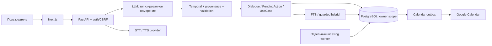

# QuickList — AI-ассистент для задач, встреч и напоминаний

QuickList превращает свободный русский текст или речь в задачи и встречи, помогает уточнить недостающие данные и найти ранее сохранённое. Проект разработан для **GORKYCODE 2026**.

**[Работающий прототип](https://quicklist-ai.com)** — для личных данных требуется регистрация и подтверждение email. Ссылку на репозиторий владелец добавит после публикации.

Backend-код: `cf3f09b0ffe339c8`; проверенный production frontend build: `1xrOHW4t65_LIcJDgw75r`; Alembic: `0009`. Этот пакет сохраняет runtime-код, но обновляет зависимость certifi из-за security advisory и исключает оригинальный CSV по решению владельца. Это объяснённые отличия от production-образа, а не утверждение о полной идентичности Docker images. [Аудит публикации](docs/GITHUB-RELEASE-AUDIT.md).

> **Перед запуском:** получите оригинальный учебный CSV у организаторов. Он не включён в публичный репозиторий: право на распространение не подтверждено. [Путь и SHA-256](data/README.md). Проверенный production-код требует оригинал до первого входа; синтетический пример формата его не подменяет. Без этого внешнего входного файла полный account setup не завершится.

## Возможности

- Текстовый AI и голосовой ввод; текстовые ответы и ручной/автоматический TTS.
- Задачи, напоминания и встречи; список за день/неделю/период и история.
- Относительные даты, интервалы «через полчаса», словесное время и уточнения.
- Сохранённый контекст, изменение, выполнение, удаление с подтверждением; дубли, прошедшее время и пересечения встреч обрабатываются сервером.
- Повторяющиеся события и выбор отдельного occurrence.
- PostgreSQL FTS/trigram; опциональный guarded Hybrid Search и отдельный embedding worker.
- Собственные аккаунты, email verification/reset, изоляция событий и диалогов.
- Google OAuth/Calendar: подключение и отдельное включение синхронизации. Подключение само по себе не экспортирует данные.

У каждого пригодного для входа аккаунта — собственная независимая копия исходных 1000 учебных событий. Изменения и мягкое удаление не сбрасываются при повторном входе; исходный набор автоматически не отправляется в Google Calendar.

## Стек

| Область | Реализация |
|---|---|
| Frontend | Next.js 16.4.3, React 19.3.1, TypeScript, Tailwind, Radix primitives |
| Backend | Python 3.13 для проверенного выпуска, FastAPI, Pydantic, SQLAlchemy, Alembic |
| Данные | PostgreSQL 17 / pgvector 0.8.7, UUID и owner_id, JSONB для диалогов |
| AI | OpenAI Responses / structured output, STT, TTS, text-embedding-3-large /1536 |
| Даты | datetime/zoneinfo, dateutil и собственные детерминированные правила |
| Поиск | FTS/trigram, pgvector, RRF и проверка обязательных ограничений результата |
| Интеграции | Google OAuth/Calendar API; SMTP, включая Resend |
| Инфраструктура | Docker Compose, Linux, Caddy; постоянные раздельные AI-ledger |

Точные Python-версии — [constraints](deploy/python.constraints), Node — package-lock.json. Прямые зависимости также объявлены в backend/pyproject.toml. Auth использует случайные opaque session cookies и БД, **не JWT**.

## Архитектура



LLM не выбирает произвольный SQL и не меняет БД. Даты, выбор записей, подтверждения, авторизация и транзакции выполняются кодом. [Архитектура для технического жюри](docs/ARCHITECTURE.md).

## Быстрый запуск — Docker Desktop / Linux

Нужны Git для клонирования (либо распакованный source ZIP), Docker Engine с Compose v2 и оригинальный CSV. На Windows используется Docker Desktop с WSL2 и **Linux containers**. Linux-контейнеры проверены на Windows/Docker Desktop; отдельная новая установка на физическом Linux-хосте не заявляется.

1. После публикации склонируйте **фактический URL владельца**, либо распакуйте source ZIP. Не используйте выдуманный URL. Перейдите в корень с README и docker-compose.yml.
2. Поместите оригинал по [инструкции данных](data/README.md), проверьте SHA-256.
3. PowerShell: `Copy-Item .env.example .env`; Linux/WSL: `cp .env.example .env`. В приватном `.env` задайте собственный `POSTGRES_PASSWORD` и соответствующий пароль в `DATABASE_URL`. Для Compose-примера используйте случайный пароль из букв/цифр, чтобы не было неоднозначного URL-экранирования. Не коммитьте `.env`.
4. Выполните:

```sh
docker compose -f docker-compose.yml -f compose.local.yml build --pull
docker compose -f docker-compose.yml -f compose.local.yml up -d --wait postgres
docker compose -f docker-compose.yml -f compose.local.yml run --rm migrate
docker compose -f docker-compose.yml -f compose.local.yml up -d --wait backend frontend
```

5. Откройте http://127.0.0.1:3000 и зарегистрируйте **собственный локальный** аккаунт. Health: http://127.0.0.1:8000/health или http://127.0.0.1:3000/api/health. Без OpenAI ожидаются `database: ok`, `llm_configured: false`, `test_mode: false` — запуск приложения не выдаётся за работающий платный AI.
6. Для настоящих текстовых и голосовых команд задайте свой `OPENAI_API_KEY`. Свежая копия намеренно имеет `AI_USAGE_MODE=capped` и нулевые allowances. Владелец новой установки самостоятельно выбирает расходы: поддерживаемые capped allocations либо явное `AI_USAGE_MODE=accounting_only`. Последний режим снимает внутренние lifetime gates и **может расходовать деньги без внутреннего потолка**, сохраняя учёт/rate/concurrency. После изменения `.env` пересоздайте только свои локальные app-контейнеры командой `up -d --force-recreate backend frontend`. Не удаляйте постоянный ledger.

Данные находятся в собственном Compose volume `quicklist-dev_dev_pgdata`; AI-учёт — в отдельном `quicklist-dev_local_ai_accounting`. `docker compose ... down` останавливает эту новую установку; **не добавляйте `-v`, если хотите сохранить данные**. Не направляйте эти команды на чужую или production-конфигурацию.

[Полная инструкция, native development, тесты и troubleshooting](docs/SETUP.md).

## Примеры GORKYCODE

- «Напомни мне завтра в 10 утра позвонить Ивану».
- «Добавь встречу с командой завтра в 15:00».
- «Что у меня сегодня?»
- «Найди задачу про презентацию».

Уточнение: «Поставь встречу с Иваном завтра» → вопрос о времени → «В одиннадцать утра» → одна встреча с сохранёнными названием и датой. «Создай напоминание через полчаса проверить материалы» вычисляет дату и время кодом; ввод ЧЧ:ММ не требуется.

Голос: выключите автоотправку, нажмите микрофон, произнесите команду, остановите запись, проверьте транскрипцию и отправьте один раз. Ответ можно озвучить. Микрофон требует разрешения браузера и secure context (HTTPS либо localhost). [Короткая демонстрация](docs/DEMO.md).

## Дополнительные сервисы

- **Google Calendar** выключен в свежем env. Нужны собственный Web OAuth Client, `GOOGLE_CLIENT_ID`, `GOOGLE_CLIENT_SECRET`, случайный постоянный `GOOGLE_TOKEN_KEY` и точный `GOOGLE_REDIRECT_URI`. Безопасная генерация ключа: `python -c "import base64,secrets; print(base64.urlsafe_b64encode(secrets.token_bytes(32)).decode())"` — выполняйте локально и сохраняйте результат только приватно. Audience/Publishing/verification настраивает владелец Google Cloud. Scope — openid/email/calendar.events.owned. Сначала подключение, затем отдельное включение sync; массового импорта Google Calendar нет.
- **SMTP/Resend** не нужен для локальной конфигурации с verification=false. Для публичного режима требуются HTTPS, Secure cookies, обязательная verification и реальная доставка. В своём env: MAIL_HOST=smtp.resend.com, MAIL_USERNAME=resend, MAIL_PORT=465, MAIL_SSL=true, собственные MAIL_FROM/MAIL_PASSWORD/SUPPORT_EMAIL. 587 использует STARTTLS. Ключ не должен попадать в frontend или Git.
- **Hybrid Search/worker** выключены в default. FTS/trigram доступны без embeddings. Включение оплачиваемой индексации требует собственного постоянного ledger, проверки реального cluster ID/marker и совместимого профиля: [настройка](docs/SETUP.md#hybrid-search-и-worker). Нельзя снимать target guard или копировать идентификатор чужой primary. Пакет не содержит пользовательских vectors или готового production cache.

## Тестирование

```sh
# Из backend, после установки dev dependencies:
python -m pytest tests/test_relative_spoken_pipeline.py tests/test_provider.py tests/test_cutover_preparation.py -q
python -m ruff check app tests ../scripts/import_dataset.py
# Из корня:
python scripts/run_evals.py --offline
# Из frontend:
npm ci
npm test
npm run typecheck
npm run lint
npm run build
```

Полные тесты могут требовать оригинального CSV и явно подтверждённых disposable PostgreSQL targets. При отсутствии соответствующего TEST_DATABASE_URL интеграционные проверки пропускаются. Суффикс `_test` сам по себе недостаточен. Не передавайте рабочую/личную БД в тесты и не ослабляйте marker/cluster guard. [Детали](docs/SETUP.md#тесты).

Предыдущая продуктовая приёмка **до этой упаковки**: 448 targeted PASS, 46 настоящих API-шагов, две физические voice-проверки; итог CONDITIONAL PASS. Эти цифры не называются новым полным QA. Новые проверки публикации и их ограничения перечислены в [release audit](docs/GITHUB-RELEASE-AUDIT.md).

## Безопасность и ограничения

Не публикуйте `.env`, ключи, OAuth credentials, DB dumps, session state или AI-ledger. Для новой установки используйте собственные secrets и отдельные volumes; локальный HTTP-профиль не предназначен для публикации в интернет. [Security](docs/SECURITY.md).

Известные ограничения: Google может показывать UNVERIFIED APP warning; официальный процесс Google verification не объявляется завершённым. Без COUNT/UNTIL recurrence материализуется на90дней без автопродления; максимум200 occurrences за операцию. Одна выдача ограничена50, список диалогов — последние50 без пагинации. Старые события за пределами первых50 сохранённых строк доступны поиском с датой/темой. Полная автоматизированная browser DOM/console QA не подтверждена; прежние ручные устройства проверены владельцем. AI зависит от OpenAI API, биллинга и доступности поддерживаемых моделей; API не бесплатен. Изменение OPENAI_MODEL не отменяет проверки профиля в accounting transport.

Публикационный certifi исправлен, но не устанавливался на действующий VPS. Для cryptography остаются известные advisories в неиспользуемых здесь X.509/PKCS7/OpenSSL путях; применимость и остаток честно описаны в [security audit](docs/SECURITY.md). Это причина условного статуса пакета, а не заявление «уязвимостей нет».

## GORKYCODE 2026 и развитие

Реализованы четыре обязательных действия, сохранение между запросами и естественный текст/голос. [Матрица всех 69 пунктов пятистраничного задания](docs/GORKYCODE-COMPLIANCE.md). Архитектура разделяет LLM и детерминированное исполнение. Использование AI-инструментов при разработке разрешено заданием: код, тесты и документация создавались при участии Codex, требования и фактическая приёмка — совместно с владельцем. Решения не приписываются полностью ручной разработке.

Возможные улучшения: расширить проверенные языковые формулировки, пагинацию, длительную материализацию серий, browser regression и представление пользователю AI-расходов. Они не объявлены уже реализованными.

## Лицензия

Владелец пока не выбрал лицензию; LICENSE намеренно отсутствует. Условия сторонних зависимостей и assets не заменяются лицензией проекта. Права на исходный датасет не подтверждены — оригинал исключён. [Ручная публикация владельцем](GITHUB-PUBLISH-GUIDE.md).
